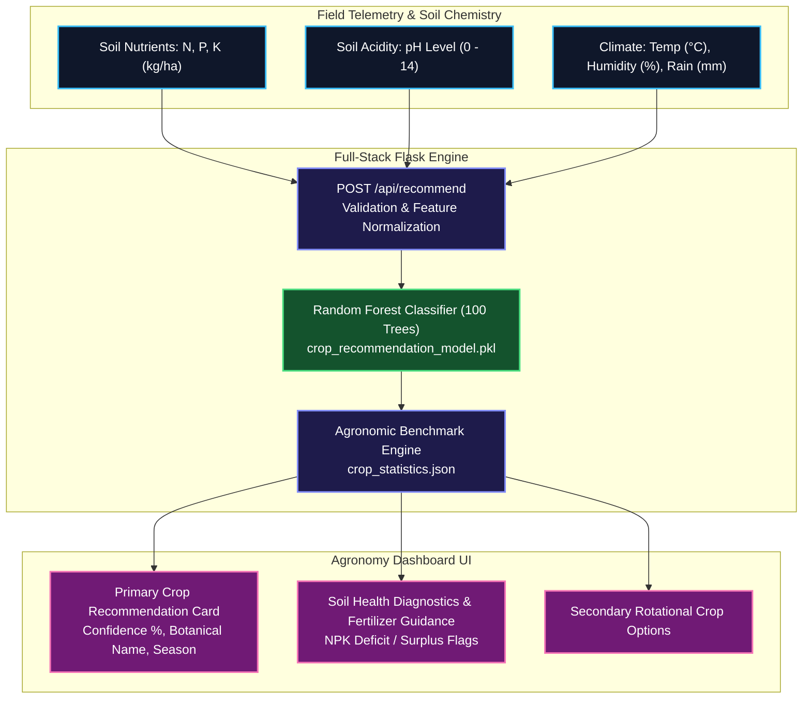

# 🌾 TerraSoil™ — Soil-Based Precision Crop Recommendation System

[](https://www.python.org/)
[](https://flask.palletsprojects.com/)
[](https://scikit-learn.org/)
[](#-machine-learning-pipeline)
[](https://github.com/Rashi-koiri/Soil_detection_prediction_crops)
[](https://opensource.org/licenses/MIT)

An end-to-end, full-stack Agricultural Decision Support & Precision Farming System. Built using **Python (Flask)** and a **Random Forest Classifier** trained on 2,200 real-world soil chemistry and agro-climatic records across 22 crop classes.

Designed specifically to operate and feel like a **scientific agronomic management dashboard** rather than an AI chatbot. It evaluates soil chemistry parameters ($N, P, K, pH$) alongside ambient meteorological telemetry ($Temperature, Humidity, Rainfall$) to deliver precise crop recommendations, fertilizer adjustment advisories, and soil health diagnoses.

---

## 📌 Table of Contents

- [Key Features](#-key-features)
- [System Architecture & Workflow](#-system-architecture--workflow)
- [Dataset Overview](#-dataset-overview)
- [Machine Learning Pipeline](#-machine-learning-pipeline)
- [Project Directory Structure](#-project-directory-structure)
- [Quick Start Guide](#-quick-start-guide)
- [REST API Reference](#-rest-api-reference)
- [Author & Acknowledgments](#-author--acknowledgments)

---

## ✨ Key Features

1. **Precision Soil Chemistry Analysis**:
   - Primary macronutrient quantification: Nitrogen ($N$), Phosphorus ($P$), Potassium ($K$) in $\text{kg/ha}$.
   - Live Soil Reaction ($pH$) classification scale (strongly acidic, slightly acidic, neutral, alkaline).
2. **Meteorological Telemetry Inputs**:
   - Ambient Temperature (°C), Relative Atmospheric Humidity (%), and Seasonal Rainfall (mm).
3. **1-Click Regional Soil Presets**:
   - Instant loading of validated field soil profiles (Indo-Gangetic Basin, Deccan Black Cotton Soil, Semi-Arid Pulse Belt, Humid Coastal Sandy-Loam, Temperate Highland).
4. **Actionable Agronomy & Fertilizer Guidance**:
   - Calculates field differences from ideal crop benchmarks and recommends specific fertilizer actions (e.g., Urea/DAP adjustments, liming for acidic soils).
5. **Secondary Rotational Candidates**:
   - Probabilistic ranking of alternative viable crop rotation candidates.
6. **Print-Ready Soil Health Report**:
   - Single-click clean printable agronomy summary sheet for farm records or soil lab deliverables.

---

## 🏗️ System Architecture & Workflow



---

## 📊 Dataset Overview

The underlying dataset comprises **2,200 multi-seasonal records** sourced from Indian and global agricultural research institutes across **22 distinct crop varieties**:

| Feature Category | Parameter | Unit | Description | Range in Dataset |
| :--- | :--- | :---: | :--- | :---: |
| **Soil Chemical** | **N** (Nitrogen) | $\text{kg/ha}$ | Primary vegetative nutrient ratio | $0 - 140$ |
| **Soil Chemical** | **P** (Phosphorus) | $\text{kg/ha}$ | Root development & flowering element | $5 - 145$ |
| **Soil Chemical** | **K** (Potassium) | $\text{kg/ha}$ | Disease resistance & drought tolerance | $5 - 205$ |
| **Soil Chemical** | **pH** | scale | Soil reaction (acidic vs alkaline) | $3.5 - 9.9$ |
| **Climate** | **Temperature** | °C | Ambient atmospheric temperature | $8.8 - 43.7\text{°C}$ |
| **Climate** | **Humidity** | % | Relative atmospheric moisture | $14.2 - 99.9\%$ |
| **Climate** | **Rainfall** | mm | Total seasonal precipitation | $20.2 - 298.6\text{ mm}$ |

### 🌾 Supported Crop Varieties (22 Classes)
- **Cereals & Cash Crops**: Rice, Maize, Cotton, Jute
- **Pulses & Legumes**: Chickpea, Kidney Beans, Pigeon Peas, Moth Beans, Mung Bean, Black Gram, Lentil
- **Fruits & Horticultural Crops**: Banana, Mango, Grapes, Watermelon, Muskmelon, Apple, Orange, Papaya, Pomegranate, Coconut
- **Plantation Cash Crops**: Coffee

---

## 🤖 Machine Learning Pipeline

- **Algorithm**: Random Forest Classifier with bootstrap aggregating (bagging)
- **Hyperparameters**: `n_estimators=100`, `criterion='gini'`, `random_state=42`
- **Validation**: Stratified 80:20 Train-Test split (1,760 training samples / 440 testing samples)
- **Evaluation Accuracy**: **99.55%** on unseen test records
- **Serialization**: Saved as `crop_recommendation_model.pkl` via Joblib for high-throughput zero-latency inference

---

## 📂 Project Directory Structure

```text
Soil_detection_prediction_crops/
├── Crop_recommendation.csv       # Complete 2,200-sample raw dataset
├── train_model.py                # Standalone script to train & evaluate the ML model
├── crop_recommendation_model.pkl # Trained Random Forest model binary
├── crop_statistics.json          # Benchmark averages & metadata for 22 crops
├── app.py                        # Full-stack Flask application & REST API
├── run.bat                       # 1-Click launcher for Windows
├── requirements.txt              # Dependency specifications
├── .gitignore                    # Git tracking exemptions
├── templates/
│   └── index.html                # Responsive precision agronomy UI
└── static/
    ├── style.css                 # Clean agricultural styling & print layout
    └── script.js                 # Reactive sliders, live pH gauge, AJAX caller
```

---

## 🚀 Quick Start Guide

### Prerequisites
- Python 3.10, 3.11, or 3.12 installed.
- Git installed.

### 1. Clone the Repository
```bash
git clone https://github.com/Rashi-koiri/Soil_detection_prediction_crops.git
cd Soil_detection_prediction_crops
```

### 2. Install Dependencies
```bash
pip install -r requirements.txt
```

### 3. (Optional) Re-train the Model
The repository already includes the pre-trained `crop_recommendation_model.pkl`. To re-train from scratch:
```bash
python train_model.py
```

### 4. Run the Web Application
#### On Windows:
Double-click `run.bat` or run:
```powershell
python app.py
```

#### On Linux / macOS:
```bash
python3 app.py
```

### 5. Access the Platform
Open your browser and navigate to:
```text
http://127.0.0.1:5000
```

---

## 🔌 REST API Reference

The Flask backend provides clean REST endpoints for mobile app or headless system integrations:

### `POST /api/recommend`
Evaluates soil & weather inputs and returns the optimal crop recommendation with diagnostics.

#### Request Headers
```http
Content-Type: application/json
```

#### Request Payload
```json
{
  "N": 90.0,
  "P": 42.0,
  "K": 43.0,
  "ph": 6.5,
  "temperature": 25.0,
  "humidity": 82.0,
  "rainfall": 240.0
}
```

#### Response Payload (`200 OK`)
```json
{
  "status": "success",
  "prediction": {
    "crop": "rice",
    "display_name": "Paddy Rice (Oryza sativa)",
    "category": "Cereal Grain / Kharif",
    "confidence": 98.5,
    "season": "Monsoon / Kharif (June - November)",
    "growth_duration": "105 - 150 Days",
    "water_requirement": "High (Standing water 5 - 10 cm)",
    "soil_suitability": "Clayey, heavy loam with high water retention capacity",
    "fertilizer_guidance": "Requires balanced N-P-K (approx 120:60:40 kg/ha). Split Nitrogen application between tillering and panicle initiation."
  },
  "soil_health_assessment": {
    "ph_value": 6.5,
    "ph_classification": "Neutral (Optimal biological nutrient uptake)",
    "nitrogen_status": "Optimal",
    "phosphorus_status": "Optimal",
    "potassium_status": "Optimal",
    "diagnostics": [
      "Soil nutrients and climatic parameters closely align with optimal agronomic growth curves."
    ]
  },
  "alternatives": [
    { "crop": "jute", "display_name": "Jute / Golden Fiber", "probability": 1.2, "season": "Kharif" }
  ]
}
```

---

## 👨‍💻 Author & Acknowledgments

- **Developer**: [Rashi Koiri](https://github.com/Rashi-koiri)
- **Repository**: [Soil_detection_prediction_crops](https://github.com/Rashi-koiri/Soil_detection_prediction_crops)
- **Inspiration**: Empowering farmers and agriculturalists with data-driven precision tools for sustainable crop rotation and fertilizer management.

---

## 📄 License
This project is open-source and distributed under the [MIT License](LICENSE).
